<div align="center">



<br/>


<br/><br/>

[**GitHub Profile**](https://github.com/Mogapis) &nbsp;·&nbsp; [**Repositories**](https://github.com/Mogapis?tab=repositories)

</div>

<br/>

## `01` &nbsp;/&nbsp; About

```bash
root@mogapis:~$ whoami
Khutso Sekele — Computer Science Student · Software Developer
```

I'm a Computer Science student interested in how software really works, from
application-level development down to lower-level system concepts.

I enjoy building practical projects, experimenting with different technologies,
and developing a deeper understanding of software engineering. My long-term
interests are **systems programming**, **operating system development** and
**artificial intelligence**.

<br/>

## `02` &nbsp;/&nbsp; Focus Areas

| Area | Focus |
|:---|:---|
| **Systems Programming** | C++, low-level programming, OS concepts |
| **Software Engineering** | Application architecture, problem-solving |
| **Web Development** | Full-stack applications, backend development |
| **Artificial Intelligence** | Machine learning, deep learning |
| **Databases** | Relational database design, SQL |

<br/>

## `03` &nbsp;/&nbsp; Tech Stack

```bash
root@mogapis:~$ ls ./stack
```

<p>
  <b>Languages</b><br/>
  
</p>
<p>
  <b>Databases &amp; Frameworks</b><br/>
  
</p>
<p>
  <b>Tools</b><br/>
  
</p>

<br/>

## `04` &nbsp;/&nbsp; Featured Projects

<table>
  <tr>
    <td width="50%" valign="top">
      <h3>🌱 Smart Irrigation System</h3>
      <sub><code>C++</code> · <code>Raspberry Pi</code> · <code>Hardware</code></sub>
      <p>Automated irrigation with soil-moisture monitoring, sensor input, pump control and manual override.</p>
      <a href="https://github.com/Mogapis/smart_i"><b>View repository →</b></a>
    </td>
    <td width="50%" valign="top">
      <h3>🛒 Nova C2C</h3>
      <sub><code>PHP</code> · <code>MySQL</code> · <code>JavaScript</code></sub>
      <p>Customer-to-customer marketplace with authentication, product management and database integration.</p>
      <a href="https://github.com/Mogapis/Nova_c2c_website"><b>View repository →</b></a>
    </td>
  </tr>
  <tr>
    <td width="50%" valign="top">
      <h3>🏓 Ping Pong Game</h3>
      <sub><code>C++</code> · <code>raylib</code></sub>
      <p>A graphical game built with C++ and raylib.</p>
      <a href="https://github.com/Mogapis/Ping-Pong-raylib-_game"><b>View repository →</b></a>
    </td>
    <td width="50%" valign="top">
      <h3>🏦 Bank System</h3>
      <sub><code>C++</code> · <code>Fundamentals</code></sub>
      <p>A banking system exploring programming logic and application development in C++.</p>
      <a href="https://github.com/Mogapis/BankSystem"><b>View repository →</b></a>
    </td>
  </tr>
</table>

<br/>

## `05` &nbsp;/&nbsp; Currently Exploring

```text
[01]  Systems programming
[02]  Operating system development
[03]  C++ and software architecture
[04]  Machine learning and deep learning
[05]  Backend engineering and APIs
```

<br/>

## `06` &nbsp;/&nbsp; Philosophy

```cpp
while (learning) {
    build();
    experiment();
    solve_problems();
    improve();
}
```

> I believe in understanding the systems behind the software, not just making the software work.

<br/>

<div align="center">


<code>BUILD · BREAK · UNDERSTAND · REBUILD</code>

<sub>© Khutso Sekele · Mogapis</sub>

</div>
